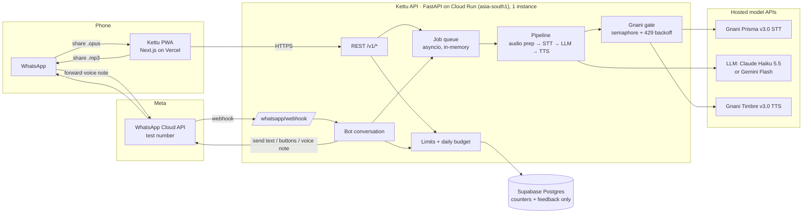
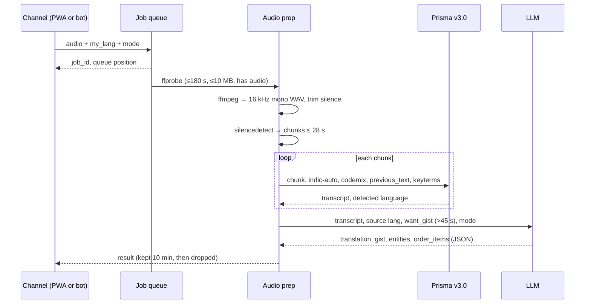
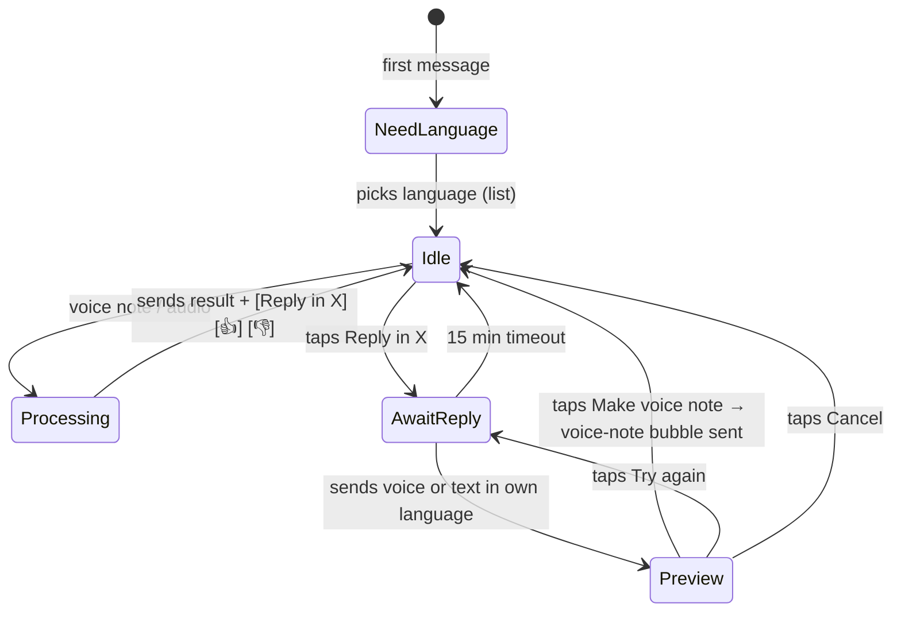

# Kettu architecture

Kettu (കേട്ടു, Malayalam for "heard") turns any WhatsApp voice note into text in your language, adds a two-line gist when the note is long, and lets you answer with a voice note spoken in the sender's language.

Everything runs in the cloud and every model is an API call: Gnani Prisma v3.0 listens, a hosted LLM translates and summarises, Gnani Timbre v3.0 speaks.

## 1. Using Kettu on your own WhatsApp

WhatsApp gives a third-party app three ways in. Kettu ships the first two; the third is ruled out.

| | A. Share sheet (PWA) | B. Kettu bot number (Meta Cloud API) | C. Linking your personal account (whatsapp-web.js / Baileys) |
|---|---|---|---|
| How it feels | Long-press voice note → Share → Kettu. Reply: Kettu makes the audio → Share → pick chat | Forward the voice note to the "Kettu" contact inside WhatsApp. Kettu answers in the same chat with the translation, gist and buttons. Reply voice note comes back as a real voice-note bubble you forward on | Kettu reads your chats directly |
| Meta approval | None | None for personal use: Meta's free test number talks to up to 5 numbers you verify. Public launch needs business verification | Not allowed |
| Works on | Android Chrome (share target); iPhone and desktop via upload | Any phone with WhatsApp | — |
| Reply arrives as | Audio file (plays in chat) | Voice-note bubble (OGG/Opus, `voice: true`) | — |
| Risk | Low | Low; test token rotation, 24 h session window (fine: you always message first) | Breaks WhatsApp Terms, number can be banned, reads other people's chats. **Not built** |

B also runs through **Twilio's WhatsApp sandbox**, which needs no Facebook account: same bot, numbered menus instead of tap buttons, reply audio served from a 10-minute in-memory link that Twilio fetches (`whatsapp/twilio.py`).

**Recommendation:** run both. The PWA is the public product from the PRD (anyone can try it from the post, no sign-up). The bot is the best way to use Kettu yourself every day and makes the demo look native: everything happens inside WhatsApp.

Both channels call the same core pipeline, share one Gnani request queue, and obey the same per-person limits.

## 2. System overview

Kettu's own code converts, queues and routes audio. Audio and results are held temporarily; transcripts and audio are never written to Supabase. Provider retention is separate from Kettu's temporary storage. See [the review](REVIEW.md) for current Render deployment details and release limitations.

## 3. Components

### Backend (`backend/src/kettu`)

| Module | Job |
|---|---|
| `config.py` | All settings from env vars. Switching LLM provider is one value: `LLM_PROVIDER=anthropic\|gemini\|mock` |
| `domain/languages.py` | The ten languages: code, English name, native name, Timbre voices |
| `domain/models.py`, `domain/errors.py` | Result shapes and plain-language error codes |
| `services/audio.py` | `ffprobe` check, `ffmpeg` clean (16 kHz mono, loudness, trim), split at pauses into ≤ 28 s chunks, encode replies to MP3 or OGG/Opus |
| `services/gnani.py` | Prisma and Timbre clients. One semaphore guards every Gnani call (Gnani may allow 1 active request per account). 429 → backoff and retry. Timbre v3.0 → v2.5 fallback |
| `services/llm.py`, `services/prompts.py` | One `understand` call (translation, gist, entities, order items as JSON) and one `reply` call (target text + back-translation) per provider |
| `services/pipeline.py` | The three use cases: understand a note, preview a reply, speak a reply |
| `services/jobs.py` | Single in-process queue with visible positions, results kept 10 minutes in memory |
| `services/limits.py`, `services/store.py` | Per-device daily limits, whole-service daily budget, usage events and feedback to Supabase (numbers only) |
| `api/routes.py` | The seven REST endpoints from the PRD |
| `whatsapp/*` | Webhook (signature check, dedupe), Graph API client, bot conversation |

### Web (`web/`)

Next.js PWA on Vercel. The web manifest declares a `share_target` that accepts audio; a service worker catches the POST, parks the file in Cache Storage and opens `/share`, which submits it to the API. Upload, drag-and-drop and an in-app recorder cover iPhone and desktop. Interface in English, Malayalam, Hindi and Bengali.

### Data (`backend/sql/schema.sql`)

`usage_events`, `feedback`, `daily_budget`, plus `wa_prefs` (bot user's language and voice, keyed by a salted hash of the phone number). No audio, transcript or translation is ever written.

## 4. Flows

### Understand a note (both channels)

If the note is already in the user's language and short, the LLM call is skipped (FR5).

### Reply in their language

1. Spoken reply → Prisma in the user's own language.
2. LLM → reply in the target language written for speech (numbers as words) + back-translation for checking.
3. User approves → Timbre speaks it (WAV 24 kHz) → ffmpeg → MP3 for the PWA, OGG/Opus for the bot (WhatsApp voice-note bubble).

Timbre credits are spent only after approval.

### Bot conversation

Text commands: `help`, `language`, `orders` (next note becomes a checklist), `voice` (female/male).

## 5. Limits, cost and failure handling

* One backend instance (min 1, max 1) so the in-memory queue and the Gnani semaphore are authoritative.
* Per person per IST day: 10 notes, 5 spoken replies (env-configurable). The 11th note gets a friendly limit message, never an error.
* Whole service per day: caps on STT seconds and TTS characters. When hit, the PWA shows a waitlist screen and the bot says so.
* Silence trimmed before speech recognition; source replies capped at 700 characters and translated speech at 900.
* Gnani 429 → exponential backoff (3 tries). Model timeout → one automatic retry, then a plain message.
* Every error the user sees is a plain sentence with a code: `unsupported_file`, `too_long`, `no_speech`, `model_timeout`, `busy`, `daily_limit`, `service_budget`.

## 6. Privacy and safety

* Audio lives in a temp directory only for the job and is deleted when it ends. Results stay in memory for 10 minutes.
* Logs carry ids, durations, languages and error codes only.
* Device id is a random UUID made in the browser. Bot users are keyed by `uuid5(sha256(salt + phone))`, never the raw number.
* Third parties named in the consent screen: Gnani (audio), the LLM provider (transcript text). Use a paid API tier that does not train on API data.
* Stock Timbre voices only, no cloning. The PWA share caption and the bot both say the reply was translated by Kettu.
* WhatsApp webhook requests are verified with `X-Hub-Signature-256` (app secret). Duplicate deliveries are dropped by message id.

### Review changes (2 November 2026)

An ingress middleware bounds request bodies before multipart parsing, caps concurrent requests, and applies a process-local peer rate limit. Each queued note or direct model operation reserves its device allowance and estimated speech budget before awaiting work. A separate service operation cap bounds translation attempts when clients rotate device IDs. These remain pilot controls, not authenticated per-person quotas or a durable billing ledger.

Media downloads are streamed with size limits and provider host checks. FFmpeg rejects playlist demuxers and remote protocols; decoding is bounded even when a recording has no duration metadata. Queued uploads are removed on shutdown and queue rejection. Reporting views use the caller's RLS permissions and deny public access.

Hosted deployments can require live providers with `REQUIRE_LIVE_MODELS=true`. Local mock output is explicitly labelled in the web app and bot. Configured Supabase usage restoration now paginates and fails startup if counters cannot be restored.

## 7. Deployment

| Piece | Where | Notes |
|---|---|---|
| API | Google Cloud Run `asia-south1`, 2 vCPU / 2 GB, min 1 max 1 | Dockerfile includes ffmpeg. Render or Railway work the same way |
| Web | Vercel (Hobby), functions in `bom1` | `NEXT_PUBLIC_API_URL` points at the API |
| DB | Supabase, Mumbai | Run `backend/sql/schema.sql` once |
| Secrets | Secret Manager / Vercel env | Model keys never reach the browser |
| Monitoring | Cloud Run logs + uptime check on `/healthz` | `/healthz?deep=1` checks Gnani, LLM and Supabase |

## 8. Why not Evon?

Evon v3.3 is open weights on Hugging Face, not on Gnani's API platform yet, and Kettu runs nothing locally. Gnani does all the listening and speaking; the LLM is behind one config value so Evon can replace it once it is offered as an API.
